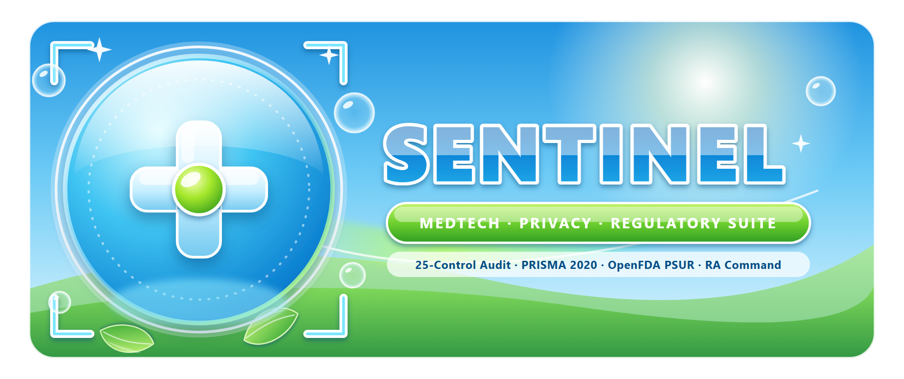

  

<h2 align="center">Kaled Bouchagraoui — MedTech, Regulatory Affairs & Digital Privacy Engineering</h2>

  <strong>Deterministic Open-Source Auditing, Clinical Evidence Synthesis (PRISMA 2020), OpenFDA Post-Market Surveillance, and Regulatory Operations Automation.</strong>

---

### Sentinel Open-Source Ecosystem

| Repository | Regulatory & Technical Scope | Key Deliverables Generated |
| :--- | :--- | :--- |
| **[`medtech-regulatory-compliance-suite`](https://github.com/kaledbouchagraoui7-bot/medtech-regulatory-compliance-suite)** | **Unified 3-Engine Suite**: • **Engine A**: 25-Control Passive Domain, DMARC & Privacy Auditor • **Engine B**: Clinical Literature & PRISMA 2020 Synthesizer • **Engine C**: RA 5-Painkiller Command Center (SLA Blame-Shield, Guidance Drift Radar, eCTD M1–M5 Cross-Check Linter) | • Swiss-Editorial 1-Page Posture Brief (`.pdf` & `.png`) • Landscape Word Audit & RA Command Briefs (`.docx`) • Filterable Multi-Sheet Excel Workbooks (`.xlsx`) • PRISMA 2020 Flow Diagram & Drop-in DNS/HTTP Configs |
| **[`sentinel-compliance-auditor`](https://github.com/kaledbouchagraoui7-bot/sentinel-compliance-auditor)** | **Standalone 100% Passive External Domain Auditor** across 5 pillars: Email Anti-Spoofing (`DMARC`/`SPF`/`CAA`), Swiss nFADP & EU GDPR Web Privacy (`Google Fonts` IP leak, cookies, trackers), Edge Security (`HSTS`, `CSP`, `X-Frame-Options`), Accessibility (`WCAG 2.1 AA`), and `Schema.org`. | • `<domain>_scorecard.pdf` & `.png` (300 DPI) • `<domain>_executive_audit.docx` • `<domain>_technical_findings.xlsx` • Turnkey `_headers`, `nginx.conf`, and DNS TXT records |
| **[`pms-clinicaltrials-openfda-monitor`](https://github.com/kaledbouchagraoui7-bot/pms-clinicaltrials-openfda-monitor)** | **EU MDR Article 83–86 (PMS / PSUR), MDCG 2022-21 & FDA 21 CFR Part 803 Surveillance Engine** querying live `OpenFDA MAUDE` (adverse events, recalls, 510(k)) and `ClinicalTrials.gov` API v2. | • Landscape Word PSUR Safety & Clinical Report (`.docx`) • 4-Sheet Filterable Surveillance Workbook (`.xlsx`) • 300-DPI Visual PMS Landscape Dashboard (`.png` & `.pdf`) |
| **[`computational-biology-portfolio`](https://github.com/kaledbouchagraoui7-bot/computational-biology-portfolio)** | **ICH E6(R2) / E9 / M4 & ALCOA+ Computational Biology Pipelines** (CFTR NCBI RefSeq QC, Clinical Trial EDA & SciPy-free Regulatory Table 1, PubMed/Europe PMC Literature Synthesizer) + **GenevaOS**. | • Reproducible Colab Notebook (`02_clinical_trial_eda.ipynb`) • Regulatory Table 1 Figure & CSV Cohort Artifacts • PMID-First Evidence Matrix (`literature_matrix.md`) |

---

### Core Engineering Principles

- **100% Passive & Non-Intrusive Observation**: External domain evaluations inspect only standard public DNS records (`cloudflare-dns.com` / `dns.google`), TLS handshake metadata, and a single standard HTTPS response (`Swiss StGB Art. 143bis` & NCSC baseline compliant).
- **ALCOA+ & Deterministic Auditability**: Every clinical, regulatory, and post-market finding traces directly to verifiable primary records (`PMID`, `NCTId`, `MAUDE MDR Report Key`, or raw HTTP/DNS evidence).
